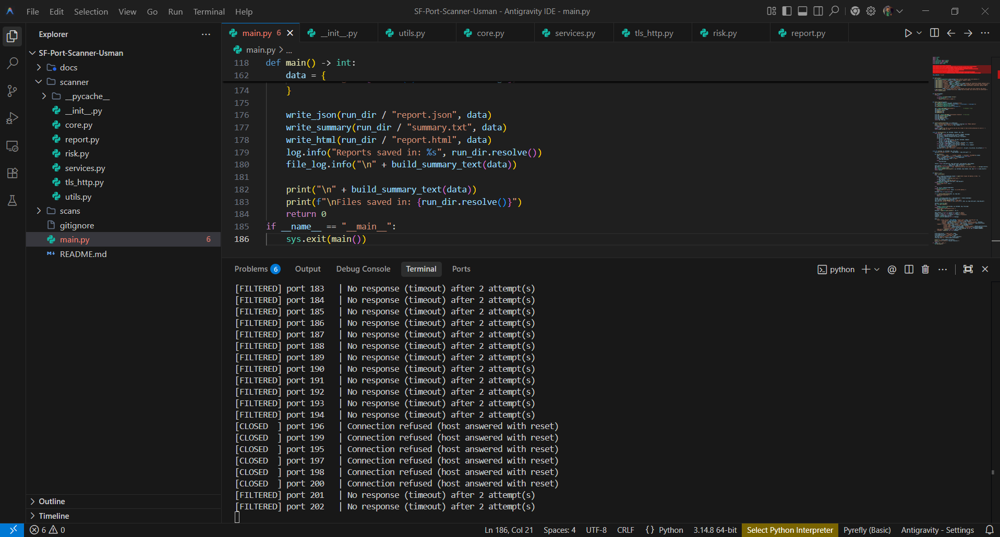
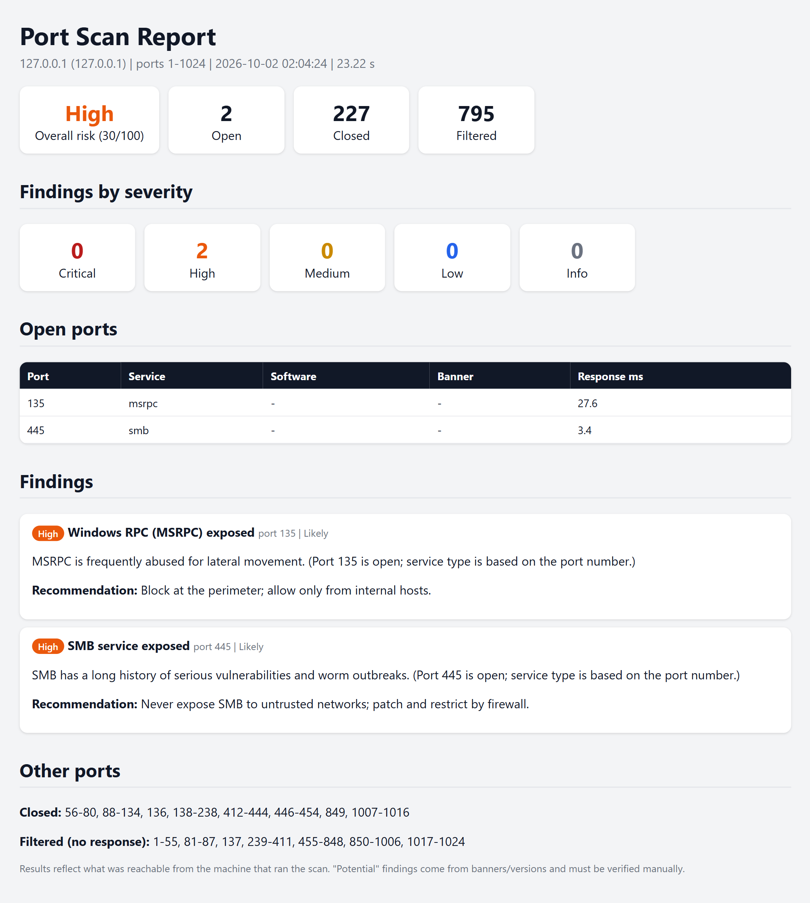

<div align="center">

# 🔍 SF Port Scanner

### A fast, async port scanner that tells you *what is exposed, how risky it is, and how to fix it*


**Open ports are just the start.** This scanner identifies services, checks TLS and HTTP security, rates the risk, and saves a clean report for every scan.

[Installation](#-installation) • [Quick Start](#-quick-start) • [Features](#-features) • [Screenshots](#-screenshots) • [Tools & Technologies](#-tools--technologies) • [Troubleshooting](#%EF%B8%8F-troubleshooting) • [Responsible Use](#%EF%B8%8F-responsible-use)

</div>

---

> ⚠️ **Only scan systems you own or have written permission to test.** See [Responsible Use](#%EF%B8%8F-responsible-use).

## 📸 Screenshots

<div align="center">

**Live scan in the terminal**



**Generated HTML report**



</div>

---

## ✨ Features

| | Feature | What it does |
|---|---|---|
| ⚡ | **Fast async scanning** | Many ports checked at the same time, with adjustable speed, timeout, and retries |
| 🎯 | **Accurate port states** | `open`, `closed`, or `filtered` (no response), not just "open or not" |
| 🌐 | **Flexible targets** | Works with an IP, a domain, or a full URL |
| 🏷️ | **Service detection** | Banner grabbing to identify SSH, FTP, HTTP, SMB, RDP, databases, and more |
| 🔐 | **TLS checks** | Expired, self-signed, or mismatched certificates, and old TLS 1.0 / 1.1 support |
| 🧱 | **HTTP checks** | Missing security headers, version leaks, exposed files like `/.git/HEAD` and `/.env` |
| 🚨 | **Risk analysis** | Findings rated Critical / High / Medium / Low, with a plain-English reason and fix |
| 🧠 | **Honest confidence levels** | Every finding is labeled *Confirmed*, *Likely*, or *Potential*, so nothing is overstated |
| 🗂️ | **Organized reports** | A separate folder for every scan, with `.log`, `.txt`, `.json`, and `.html` outputs |
| 🛡️ | **Built-in safety** | Asks you to confirm you are authorized before every scan |

---

## 🧰 Tools & Technologies

| Tool | Purpose | Required? |
| --- | --- | --- |
| **Python 3.10+** | The language the whole project is written in | ✅ Yes |
| **Git** | To download (clone) the project from GitHub | Optional (you can download a ZIP instead) |
| **Any code editor** | To read or change the code (for example VS Code) | Optional |
| **A web browser** | To open the `report.html` reports | ✅ Yes (any browser) |

### 📦 Libraries: nothing to install

This project uses **only Python's built-in standard library**. That means there is **no `pip install` step and no `requirements.txt`**. The built-in modules it relies on:

| Module | Used for |
| --- | --- |
| `asyncio` | Checking many ports at the same time |
| `socket`, `ipaddress` | Network connections, DNS lookups, IP validation |
| `ssl` | TLS certificate and protocol checks |
| `http.client` | HTTP security header and exposed-path checks |
| `argparse` | Command-line options |
| `logging` | Writing the `.log` file |
| `json`, `html`, `pathlib`, `dataclasses`, `datetime` | Reports, file handling, and data structures |

---

## 📋 Requirements

- **Python 3.10 or newer**
- Windows, macOS, or Linux (developed and tested on **Windows with Python 3.14**; it should work on macOS and Linux but has not been tested there)
- Internet access only if you scan a remote target (not needed for `127.0.0.1`)

---

## 🔧 Installation

### Step 1: Install Python (skip if you already have it)

Check first:

```bash
python --version
```

If you see `Python 3.10` or higher, you are ready. Otherwise install it:

**Windows** (either way works)

- Download from [python.org/downloads](https://www.python.org/downloads/) and during setup **tick "Add python.exe to PATH"**, or
- In PowerShell:

```powershell
winget install Python.Python.3.12
```

**macOS** (with [Homebrew](https://brew.sh))

```bash
brew install python
```

**Ubuntu / Debian Linux**

```bash
sudo apt update
sudo apt install python3 -y
```

> On macOS and Linux, use `python3` instead of `python` in all the commands in this README.

### Step 2: Download the project

**Option A: with Git**

Install Git if you do not have it (`git --version` to check):

```powershell
# Windows
winget install Git.Git
```

```bash
# macOS
brew install git

# Ubuntu / Debian
sudo apt install git -y
```

Then download the project:

```bash
git clone https://github.com/Usmanxsoc/SF-Port-Scanner-Usman.git
cd SF-Port-Scanner-Usman
```

**Option B: without Git**

1. Click the green **Code** button at the top of this page.
2. Click **Download ZIP** and extract it.
3. Open a terminal inside the extracted folder.

### Step 3: Install libraries

Nothing to do. There are no extra libraries. You are ready to scan.

---

## 🚀 Quick Start

Run these commands from the project's main folder (the one that contains `main.py`):

```bash
python main.py 127.0.0.1 1 1024
```

When asked, type `YES` to confirm you are allowed to scan the target.

### More examples

```bash
python main.py                                  # interactive mode (it asks you questions)
python main.py 127.0.0.1 1 1024 --open-only     # show only open ports in the terminal
python main.py example.com 443 443              # check a single port
python main.py scanme.nmap.org 1 1024 --open-only --concurrency 50   # gentle scan of the official test server
```

<details>
<summary><b>⚙️ All options</b></summary>

| Option | Default | Description |
| --- | --- | --- |
| `--timeout` | `2.0` | Seconds to wait for each connection attempt |
| `--retries` | `1` | Extra attempts before a port is called filtered |
| `--concurrency` | `200` | How many ports are checked at the same time |
| `--output-dir` | `scans` | Folder where reports are saved |
| `--open-only` | off | Show only open ports in the terminal (everything is still saved to the log) |
| `--yes` | off | Skip the confirmation prompt (you are confirming you are authorized) |

</details>

---

## 📂 What You Get After Every Scan

Each scan creates its own folder, so results never get mixed up:

```
scans/
└── 127.0.0.1/
    └── 2026-10-02_14-30-00/
        ├── 127.0.0.1_2026-10-02_14-30-00.log   ← every port result + final summary
        ├── summary.txt                          ← easy-to-read summary
        ├── report.json                          ← full data for other tools
        └── report.html                          ← styled report, open in your browser
```

### Port states in plain English

| State | What it means |
| --- | --- |
| 🟢 **Open** | A service is listening and answered |
| 🔴 **Closed** | The machine answered "nothing here" (reachable, but no service) |
| 🟡 **Filtered** | No answer at all, usually a firewall quietly dropping the traffic |

### Example finding

```
[HIGH] SMB service exposed (port 445, Likely)
    Why : SMB has a long history of serious vulnerabilities and worm outbreaks.
    Fix : Never expose SMB to untrusted networks; patch and restrict by firewall.
```

*(Example for illustration.)*

---

## 🔎 What It Checks

<details>
<summary><b>🚪 Risky exposed services</b></summary>

Telnet, FTP, TFTP, SMB, MSRPC, NetBIOS, RDP, VNC, WinRM, an exposed Docker API, and databases such as MySQL, PostgreSQL, MSSQL, MongoDB, Redis, Elasticsearch, and Memcached.

</details>

<details>
<summary><b>🔐 TLS / HTTPS</b></summary>

Expired, self-signed, untrusted, or mismatched certificates; certificates expiring within 30 days; servers that still accept TLS 1.0 or 1.1.

</details>

<details>
<summary><b>🧱 Web server (HTTP)</b></summary>

Version leaks in `Server` and `X-Powered-By`; missing `Strict-Transport-Security`, `Content-Security-Policy`, `X-Content-Type-Options`, `Referrer-Policy`, and clickjacking protection; exposed `/.git/HEAD`, `/.env`, phpMyAdmin, and Apache `server-status`. It also avoids false alarms on sites that return "200 OK" for every page.

</details>

<details>
<summary><b>📦 Outdated software banners</b></summary>

A small set of clearly outdated or known-bad versions, such as old OpenSSH, end-of-life Apache, IIS, and PHP, and the backdoored vsFTPd 2.3.4 release.

</details>

### Confidence levels

| Level | Meaning |
| --- | --- |
| ✅ **Confirmed** | Directly observed (for example an expired certificate) |
| 🟠 **Likely** | Based on which port is open |
| ❓ **Potential** | Based on a banner or version text, so it must be verified manually |

---

## 🧩 How It Works

```
Target ➜ Validate & resolve ➜ Confirm authorization ➜ Async port scan
      ➜ Banner + service detection ➜ TLS & HTTP checks
      ➜ Risk rules ➜ Findings with severity ➜ Log + TXT + JSON + HTML report
```

## 🗂️ Project Structure

```
.
├── main.py              # starts the scan, handles logging and reports
├── README.md            # this file
├── LICENSE              # MIT License
├── .gitignore           # keeps scan results out of the repository
├── docs/
│   └── screenshots/     # images used in this README
└── scanner/
    ├── __init__.py      # marks this folder as a Python package
    ├── core.py          # async TCP scanning and port states
    ├── services.py      # service identification and banner grabbing
    ├── tls_http.py      # TLS and HTTP security checks
    ├── risk.py          # risk rules, severity, and scoring
    ├── report.py        # JSON, text, and HTML report writers
    └── utils.py         # target parsing, DNS, and validation helpers
```

---

## 🛠️ Troubleshooting

<details>
<summary><b>"python" is not recognized (Windows)</b></summary>

Python is either not installed or not added to PATH. Reinstall it from [python.org](https://www.python.org/downloads/) and tick **"Add python.exe to PATH"**. You can also try `py main.py ...` instead of `python main.py ...`. On macOS and Linux, use `python3`.

</details>

<details>
<summary><b>ModuleNotFoundError: No module named 'scanner'</b></summary>

You are running the command from the wrong folder. Open the terminal in the main project folder (the one that contains `main.py`) and run it again. Also check that the `scanner` folder name is all lowercase.

</details>

<details>
<summary><b>can't open file ... main.py</b></summary>

Same cause: you are not in the folder that contains `main.py`. Use `cd` to move into the project folder first.

</details>

<details>
<summary><b>Many ports show as "filtered" on 127.0.0.1</b></summary>

On Windows, closed local ports can take a moment to refuse connections, so some time out and show as filtered. Try a longer timeout and fewer simultaneous checks:

```bash
python main.py 127.0.0.1 1 1024 --timeout 4 --concurrency 100
```

</details>

<details>
<summary><b>Everything shows as "filtered" on a remote target</b></summary>

Your network, ISP, or the target's firewall may be blocking the scan. Try a different network (for example a phone hotspot), and make sure you have permission to scan that target.

</details>

<details>
<summary><b>I cannot find the .log file</b></summary>

It is saved inside the scan's own folder, for example `scans/127.0.0.1/<date_time>/`. The terminal prints the exact folder path at the end of every scan.

</details>

---

## 🚧 Limitations

- TCP only (no UDP) and IPv4 only
- Full-connection scan, not a stealth SYN scan, so it is visible in logs
- Banner-based findings are **not proof** of a vulnerability, which is why they are marked *Potential*
- It does not look up CVEs and does not exploit anything
- Results depend on your network. Firewalls, ISPs, and CDNs can change what you see
- If a site sits behind a CDN or hosting platform, you are scanning the provider's servers, not the site owner's

## 🛡️ Responsible Use

This tool is for **learning and authorized security testing only.**

- ✅ Scan your own machine, your own lab, or systems you have **written permission** to test
- ✅ Safe practice targets: `127.0.0.1`, intentionally vulnerable apps you run locally (OWASP Juice Shop, DVWA), and `scanme.nmap.org` (light use only)
- ❌ Do not scan other people's systems, your employer's systems without approval, or third-party infrastructure
- ❌ Do not scan the full 65,535 range against targets you do not control

The author is not responsible for misuse.

## 🗺️ Roadmap

- [ ] Compare two scans and show what changed
- [ ] CVE lookup using the NVD API
- [ ] MITRE ATT&CK mapping for findings
- [ ] Export detection ideas (Sigma-style) for newly exposed services
- [ ] UDP scanning and optional SYN scan
- [ ] Scheduled scans with change alerts
- [ ] Unit tests and CI

## 🤝 Contributing

Ideas, issues, and pull requests are welcome. For bigger changes, please open an issue first.

## 📄 License

Released under the [MIT License](LICENSE).

---

<div align="center">

### 👤 Author

**Muhammad Usman**

[](https://github.com/Usmanxsoc)
[](https://www.linkedin.com/in/muhammad-usman-sf/)

⭐ If you found this useful, consider giving the repo a star!

</div>